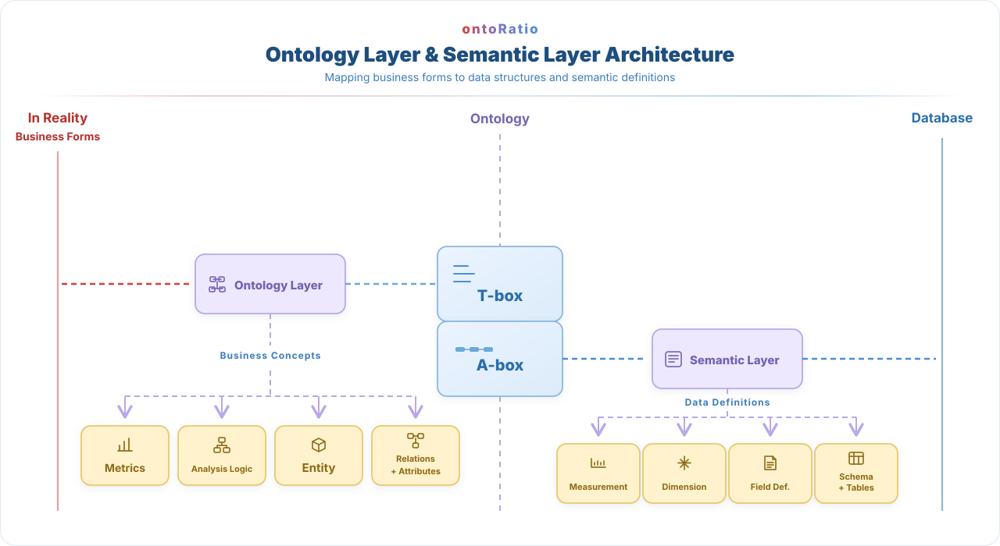

<!--
  RATIO product README for the ontoRatio GitHub project (English).
  Chinese version: README.md (default) —— keep both files in sync on every change.
-->

<h1 align="center">
  
</h1>

<!-- Badges: stars / downloads / license / supported platforms -->

  
  
  
  

<!-- Language switcher: Chinese README.md is the default, English README.en.md is the alternative -->

  <a href="README.md">中文</a> · <a href="README.en.md">English</a>

  <strong>Make data analysis accessible to people who know their business—not data science or programming.</strong>

  RATIO provides AI agents with a business framework for understanding business logic and data, so they can deliver more accurate analysis in the right context. Business users can get started with what they already know—without deep data-analysis or programming skills—and use an agent to answer everyday questions quickly. The open-source edition publishes our definition of AOL (Agent Native Ontology Language), for anyone to reference, use, and build on.

  <strong>Open source</strong> · <strong>Ontology building and editing</strong> · <strong>Customize the source</strong>

## Four steps to get started

<table width="100%">
  <tr><th width="60%">Step</th><th width="40%">Video</th></tr>
  <tr><td width="60%" valign="middle"><strong>1. Install:</strong> Install raito.</td><td width="40%" valign="middle"></td></tr>
  <tr><td width="60%" valign="middle"><strong>2. Connect a data source:</strong> Connect the business data you want to analyze.</td><td width="40%" valign="middle"></td></tr>
  <tr><td width="60%" valign="middle"><strong>3. Build an ontology:</strong> Organize business concepts, entities, relationships, and metrics.</td><td width="40%" valign="middle"></td></tr>
  <tr><td width="60%" valign="middle"><strong>4. Put it to use:</strong> Use an AI agent to analyze data in its business context.</td><td width="40%" valign="middle"></td></tr>
</table>

## What you can do with the open-source edition

Designed for everyday business questions, metric interpretation, and small-scale analysis, RATIO helps agents connect familiar business rules with data so the results are easier to get and more relevant to the business.

- **Shape business context:** Organize business concepts, metrics, entities, and relationships into a structure agents can use.
- **Build with AI assistance:** Get basic AI support for creating and editing this business framework.
- **Analyze in context:** Support data analysis across most small-ontology scenarios using business semantics.
- **Build on the source:** Modify and extend the source code for your own needs.

  

- [Browse the ontoRatio source](https://github.com/QiXinZhiGuang/OntoRatio)
- [View releases and downloads](https://github.com/QiXinZhiGuang/OntoRatio/releases)
- [Share feedback or report an issue](https://github.com/QiXinZhiGuang/OntoRatio/issues)

## Our Philosophy

- **People who know the business should be the ones using the data:** You understand the business better than anyone, yet the data always takes a detour: export it first, paste it into Excel, add formulas and pivot tables, then spend meeting prep reconciling numbers that never quite match—and when someone new takes over, they start from scratch all over again. Once the table grows, Excel locks up. To save trouble you wait in the data team's queue—and if the wait is too long, many people simply set analysis aside. AI is freeing people from repetitive work; RATIO goes one step further—so that you, with your understanding of the business, can mine knowledge from data, uncover insights that truly matter, and build something new on top of them.
- **Business knowledge deserves to be captured and kept:** An ontology is, in essence, your business model projected into the digital world; the process of it taking shape is also your enterprise's digital twin slowly settling into place. It is more than a foundation for automation and intelligence—it is among your business's most valuable "metaverse" assets. Even someone who just joined can use it to quickly understand how the whole business works, and become part of the team sooner.
- **An ontology is "grown", not "built":** There is no need to aim for something big and complete from day one. Take one real business need at a time, get just enough each round, and the projection takes shape naturally.
- **Only by building together can we share together:** Just as we open-sourced the AOL definition, an ontology is never the work of one person or one team—it takes everyone in the company, building and using it together. That is the core design principle behind RATIO: "build together, share together."

**Commercial edition:** Adds online ontology sharing and version management, more accurate retrieval, enterprise-scale storage, and more precise AI-assisted ontology creation and updates. Learn more at [qxzg-ai.com](https://qxzg-ai.com).

## Development & Community

### Contributors

### Star History

  

## License

The RATIO open-source edition is released under the [Apache License 2.0](LICENSE).

If you build on or redistribute this project, please keep the [NOTICE](NOTICE) file and clearly credit the origin as the RATIO project (ontoRatio), with a link to https://github.com/QiXinZhiGuang/OntoRatio, in your documentation, an "About" page, or another prominent location.
