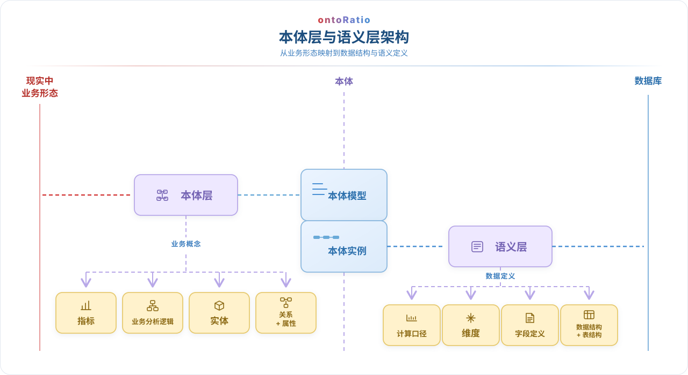

<!--
  OntoRatio README（中文，默认版本）
  RATIO 为产品名，ontoRatio 为 GitHub 项目名。
  英文版本：README.en.md —— 每次修改请同步更新两份文件。
-->

<h1 align="center">
  
</h1>

<!-- 徽章区：stars / 下载量 / 许可证 / 支持平台 -->

  
  
  
  

<!-- 多语言入口：默认中文 README.md，英文 README.en.md -->

  <a href="README.md">中文</a> · <a href="README.en.md">English</a>

  <strong>让懂业务的人，也能轻松用智能体分析数据。</strong>

  RATIO 为智能体提供理解业务逻辑与数据的业务框架，让智能体基于正确的业务语境提供更准确的数据分析。熟悉业务即可上手，无需深入掌握数据分析或编程，也能借助智能体快速、简单地完成日常分析。开源版开放了我们定义的 AOL（Agent Native Ontology Language）定义，供大家参考、使用与二次开发。

  <strong>开源版</strong> · <strong>本体构建与编辑</strong> · <strong>支持源码二次开发</strong>

## 使用步骤

<table width="100%">
  <tr><th width="60%">步骤</th><th width="40%">操作视频</th></tr>
  <tr><td width="60%" valign="middle"><strong>1. 安装：</strong>安装 raito。</td><td width="40%" valign="middle"></td></tr>
  <tr><td width="60%" valign="middle"><strong>2. 连接数据源：</strong>接入你希望使用和分析的业务数据。</td><td width="40%" valign="middle"></td></tr>
  <tr><td width="60%" valign="middle"><strong>3. 建立本体：</strong>梳理业务概念、实体、关系和指标，构建并编辑本体。</td><td width="40%" valign="middle"></td></tr>
  <tr><td width="60%" valign="middle"><strong>4. 开始使用：</strong>基于业务语境，使用智能体开展数据分析。</td><td width="40%" valign="middle"></td></tr>
</table>

## 开源版能做什么

面向日常业务问题、指标解读和小型数据分析场景，RATIO 帮助智能体结合业务人员熟悉的规则与数据来理解问题，让分析更容易上手、更贴近实际业务。

- **梳理业务框架：** 将业务概念、指标、实体和关系整理为智能体可使用的业务结构。
- **智能辅助构建：** 使用基础智能化能力辅助业务框架的构建与编辑。
- **基于业务语境分析：** 支持大多数小型本体场景的数据分析。
- **开放源码：** 可基于源代码进行二次开发，按需扩展。

  

- [浏览 ontoRatio 源码](https://github.com/QiXinZhiGuang/OntoRatio)
- [查看版本与下载](https://github.com/QiXinZhiGuang/OntoRatio/releases)
- [提交问题或需求](https://github.com/QiXinZhiGuang/OntoRatio/issues)

## RATIO的理念

- **懂业务的人，最该用得上数据：** 你比谁都懂业务，数据却总在绕圈子：先导表，再粘进 Excel，加公式、拉透视表，例会前还要为几个对不上的数字反复核对；一换人接手，又得从头摸一遍。表一大，Excel 就卡死。想省事，只能等数据团队排期，等不及，很多人干脆就把分析这事放下了。AI 正在把人从重复劳动里解放出来，RATIO 想再往前走一步：让懂业务的你，凭着自己对业务的理解，就能直接从数据里挖出知识、发现真正有价值的洞察，并由此做出创新。
- **业务知识，值得被沉淀下来：** 本体，本质上是企业的业务模型在数字世界里的投影；它一点点成型的过程，也正是企业数字孪生慢慢沉淀的过程。它不只是自动化、智能化的底座，更是企业最宝贵的“元宇宙”资产——哪怕刚入职的同事，也能借此快速看懂整个企业的业务，更快成为团队的一员。
- **本体是“长”出来的，不是“造”出来的：** 不必一上来就追求大而全，围绕一个个真实的业务需求逐步梳理，每次够用就好，投影会自然而然地长成型。
- **共建，才能共享：** 就像我们开源了 AOL 的定义一样，本体从来不是某个人、某个团队的事，而需要企业里每个人共同参与、共同使用。RATIO 的基本设计理念，正是“共建共享”。

**商业版：** 提供在线本体共享与版本管理、更准确的检索查询、企业级本体存储，以及更精确的智能化本体构建和更新服务。详情请访问 [qxzg-ai.com](https://qxzg-ai.com)。

## 开发与社区

### 贡献者

### Star 增长

  

## License

RATIO 开源版基于 [Apache License 2.0](LICENSE) 发布。

基于本项目进行二次开发或再分发时，请保留 [NOTICE](NOTICE) 文件，并在文档、关于页面或其他显著位置注明来源为 RATIO 项目（ontoRatio），并附上项目地址 https://github.com/QiXinZhiGuang/OntoRatio。
